# Elevvo Backend Internship

Backend development tasks completed during the internship.

## Level 1

### Task 1: Web Request Inspector & Raw HTTP Server

A raw Node.js HTTP server built with only the built-in `http` module (no Express or other frameworks). Source code: [`level-1/task-1-raw-http-server`](level-1/task-1-raw-http-server)

#### Run

```
cd level-1/task-1-raw-http-server
node server.js
```

The server starts on http://localhost:3000. Set a different port with the `PORT` environment variable.

#### Endpoints

| Method | Path          | Status        | Description                                   |
|--------|---------------|---------------|-----------------------------------------------|
| GET    | /             | 200 OK        | Welcome message and list of endpoints         |
| GET    | /api/users    | 200 OK        | List of sample users                          |
| GET    | /api/health   | 200 OK        | Uptime, OS platform and ISO timestamp (bonus) |
| any    | unknown path  | 404 Not Found | JSON error                                    |
| other  | known path    | 405           | Method not allowed, with an `Allow` header    |

All responses use `Content-Type: application/json`.

#### Test with cURL

```
curl -i http://localhost:3000/
curl -i http://localhost:3000/api/users
curl -i http://localhost:3000/api/health
curl -i http://localhost:3000/nope
```

#### Screenshots (Browser DevTools, Network tab)

**GET / (200 OK)**

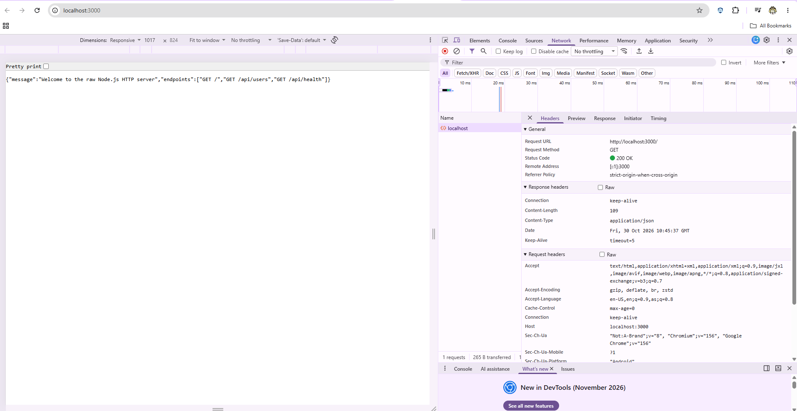

**GET /api/users (200 OK)**

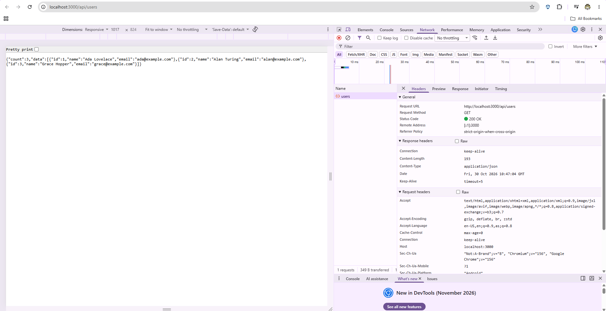

**GET /api/health (200 OK, bonus)**

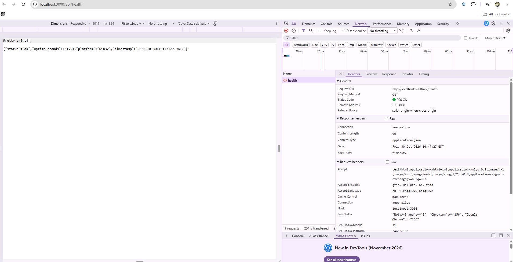

**GET /nope (404 Not Found)**

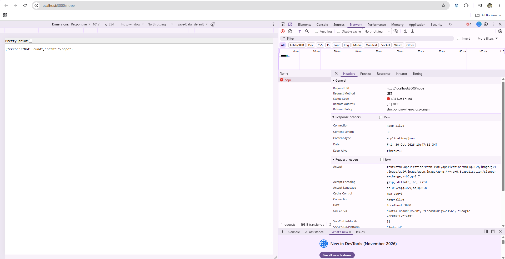

#### Concepts covered

HTTP lifecycle, client-server architecture, status codes, JSON payloads, native Node routing.


### Task 2: Fault-Tolerant Async Data Engine

An asynchronous data engine in strict TypeScript that queries several public API endpoints at once with `Promise.allSettled()`. Failures are isolated and logged, so one broken endpoint never stops the others. Source code: [`level-1/task-2-async-data-engine`](level-1/task-2-async-data-engine)

#### Highlights

- Strict `tsconfig.json` (`noImplicitAny`, `strictNullChecks` and more)
- Native `fetch` with a timeout
- Raw responses are typed as `unknown` and mapped into `User`, `Post` and `Todo` interfaces with type guards, with no `any`
- Two deliberately broken demo sources (HTTP 404 and an unreachable host) prove the error isolation

#### Run

```
cd level-1/task-2-async-data-engine
npm install
npm start
```

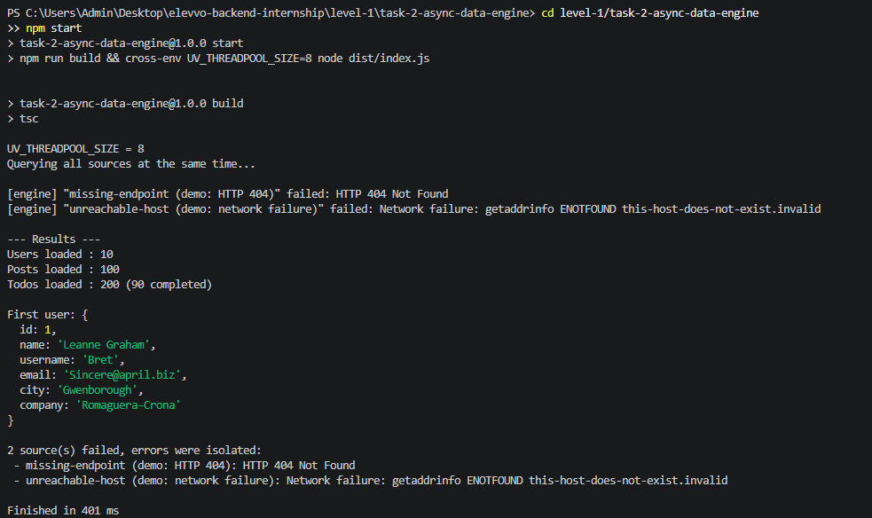

#### Bonus: UV_THREADPOOL_SIZE benchmark

```
npm run bench
```

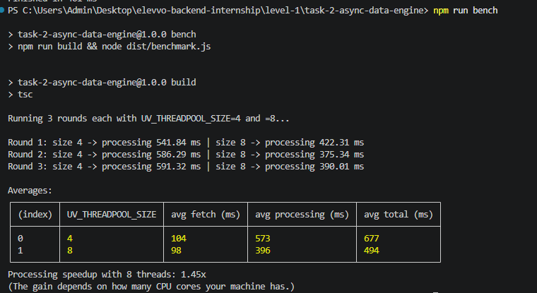

| UV_THREADPOOL_SIZE | Avg processing (ms) | Avg total (ms) |
|--------------------|---------------------|----------------|
| 4 (default)        | 573                 | 677            |
| 8                  | 396                 | 494            |

About **1.45x faster processing** with 8 threads.

#### Concepts covered

V8 and libuv architecture, strict TypeScript, Promise.allSettled, domain interfaces, asynchronous error isolation.


## Level 2

### Task 3: Observability & Modular Express API Architecture

A structured Express.js + TypeScript API split into Routes, Controllers and Services, with CRUD for `/api/users`, a global observability middleware and an API key security middleware. Source code: [`level-2/task-3-express-api`](level-2/task-3-express-api)

#### Highlights

- Controller-Service pattern: routes only map URLs, controllers handle HTTP, services hold the logic
- Observability middleware logs the ISO timestamp, method, path, status and duration in ms for every request
- Input validation with proper status codes (400, 404, 409) and JSON error payloads
- Bonus: `requireAPIKey` middleware rejects requests without a valid `x-api-key` header with `401 Unauthorized`

#### Run

```
cd level-2/task-3-express-api
npm install
npm start
```

Send the header `x-api-key: secret-key-123` with every `/api` request.

#### Screenshots

**Observability logs**

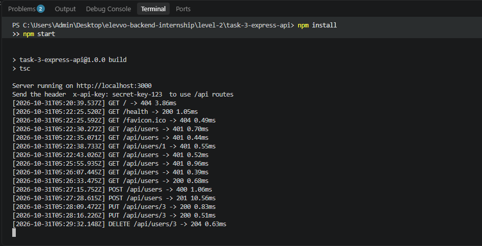

**401 Unauthorized without an API key (bonus)**

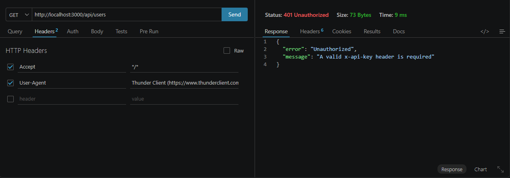

**GET /api/users (200 OK)**

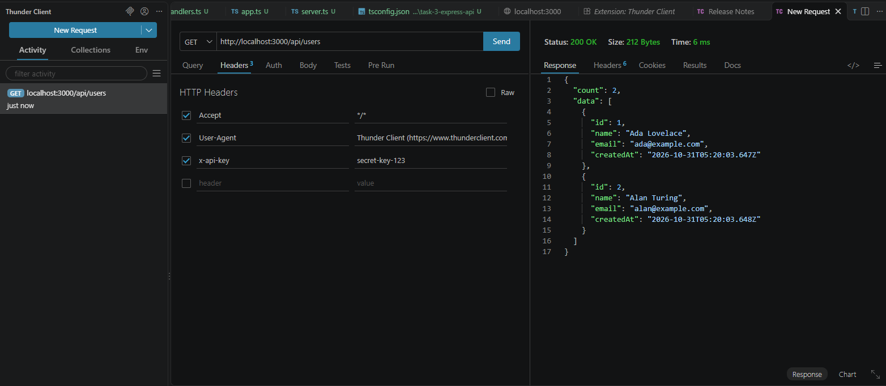

**POST /api/users (201 Created)**

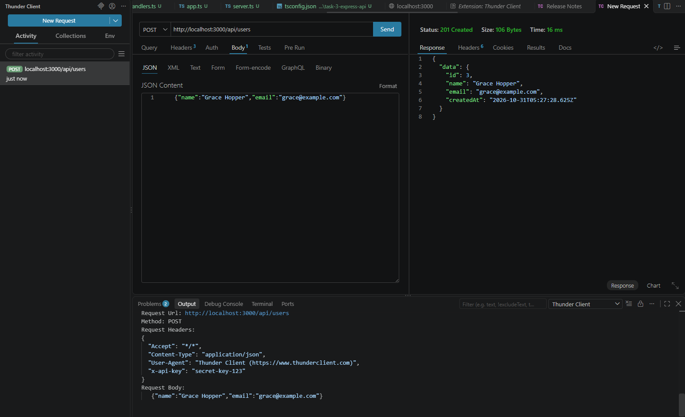

#### Concepts covered

Express framework, modular routing, custom middleware pipelines, controller-service pattern, observability logging.


### Task 4: Stateless JWT Authentication & Threat Mitigation

A secure authentication pipeline in Express.js + TypeScript: bcrypt password hashing, JWT login, `authenticateToken` and `authorizeRole` middleware (USER vs ADMIN), Helmet security headers, strict CORS and login rate limiting. Source code: [`level-2/task-4-jwt-auth`](level-2/task-4-jwt-auth)

#### Highlights

- Passwords hashed with bcrypt (salted, cost 12) and never returned to clients
- `/api/auth/login` issues a signed, 1-hour JWT with `sub`, `username` and `role` claims
- `authenticateToken` returns `401` for missing, invalid or expired tokens; `authorizeRole` returns `403` for the wrong role
- Forged tokens (tampered signature, `alg: none`) are rejected because the algorithm is pinned
- Bonus: strict CORS allow-list and a limit of 5 login requests per 15 minutes (`429`)

#### Run

```
cd level-2/task-4-jwt-auth
npm install
npm start
```

#### Screenshots

**Login (200 OK, JWT issued)**

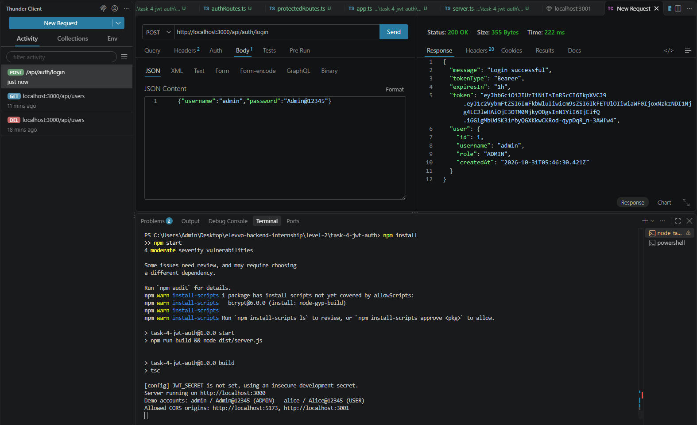

**Admin route as ADMIN (200 OK)**

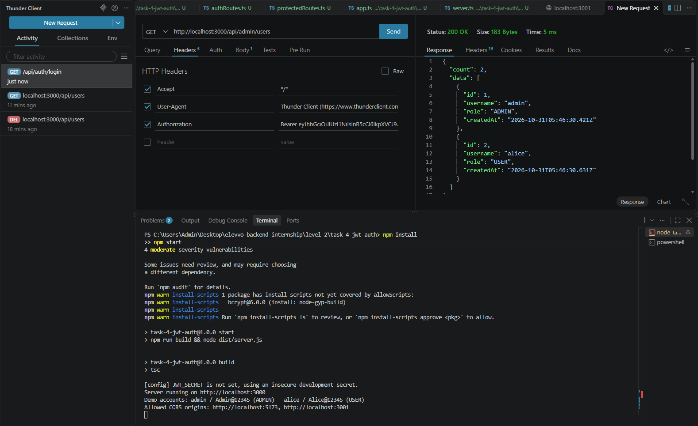

**No token (401 Unauthorized)**

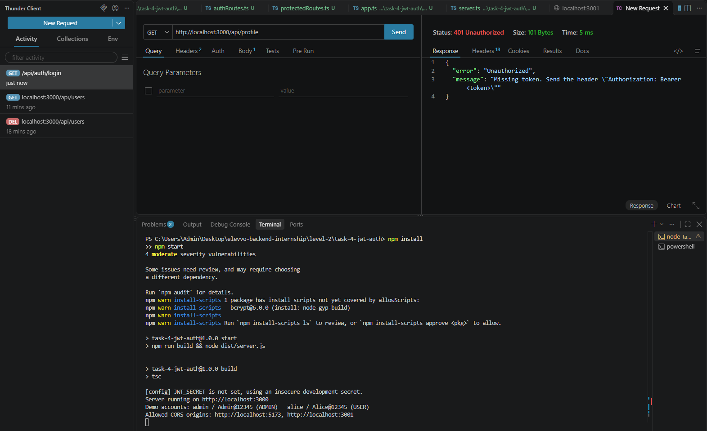

**Admin route as USER (403 Forbidden)**

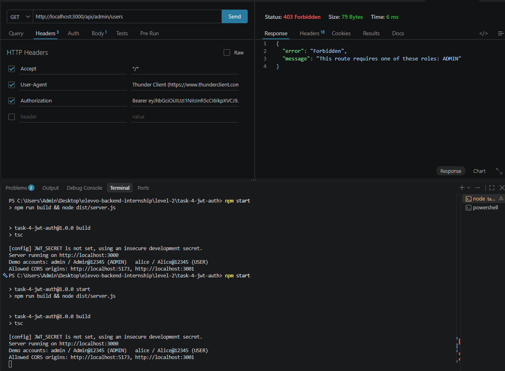

**Login rate limit (429 Too Many Requests)**

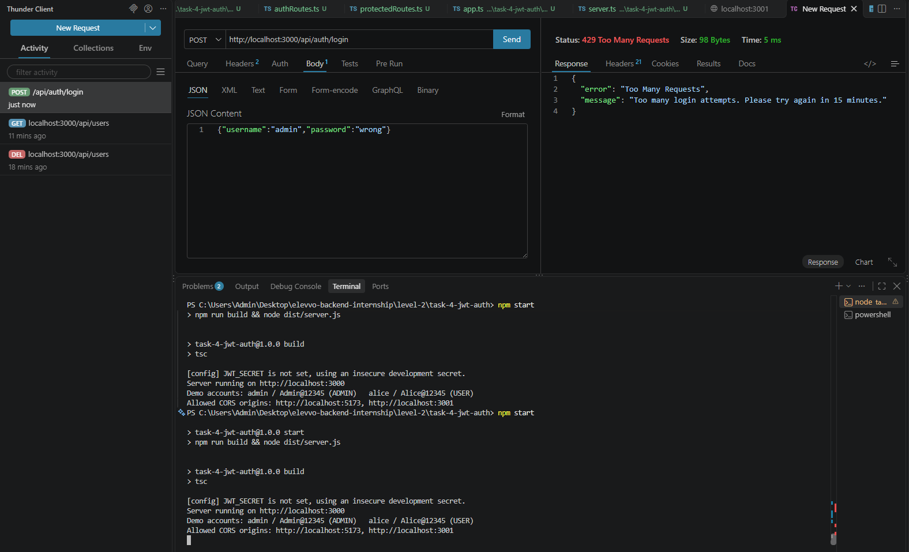

#### Concepts covered

Authentication vs. authorization, JWT architecture, password hashing, role-based access control, security headers and rate limiting.


### Task 5: Relational Persistence with PostgreSQL & Prisma ORM

An e-commerce API with a PostgreSQL database modelled in Prisma ORM: User, Order, Product and OrderItem with one-to-many and many-to-many relationships, SQL migrations, pagination, relational filtering, nested writes and an atomic checkout. Source code: [`level-2/task-5-prisma-shop`](level-2/task-5-prisma-shop)

#### Highlights

- Many-to-many between Order and Product through an explicit `OrderItem` join model that snapshots the unit price
- Migrations generated and applied with `prisma migrate dev`
- Pagination (`skip`/`take` with a `meta` object), `where` filters and relational filters (`some`)
- Nested write: order and order items created in one query
- Bonus: checkout wrapped in `prisma.$transaction`, with an atomic stock check and automatic rollback on failure

#### Run

See the [task README](level-2/task-5-prisma-shop/README.md) for the PostgreSQL setup.

```
cd level-2/task-5-prisma-shop
npm install
npx prisma migrate dev --name init
npx prisma db seed
npm start
```

#### Screenshots

**Database tables created by the migration**

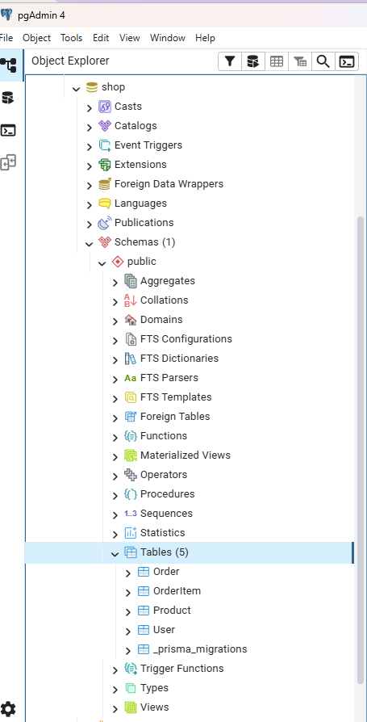

**Pagination**

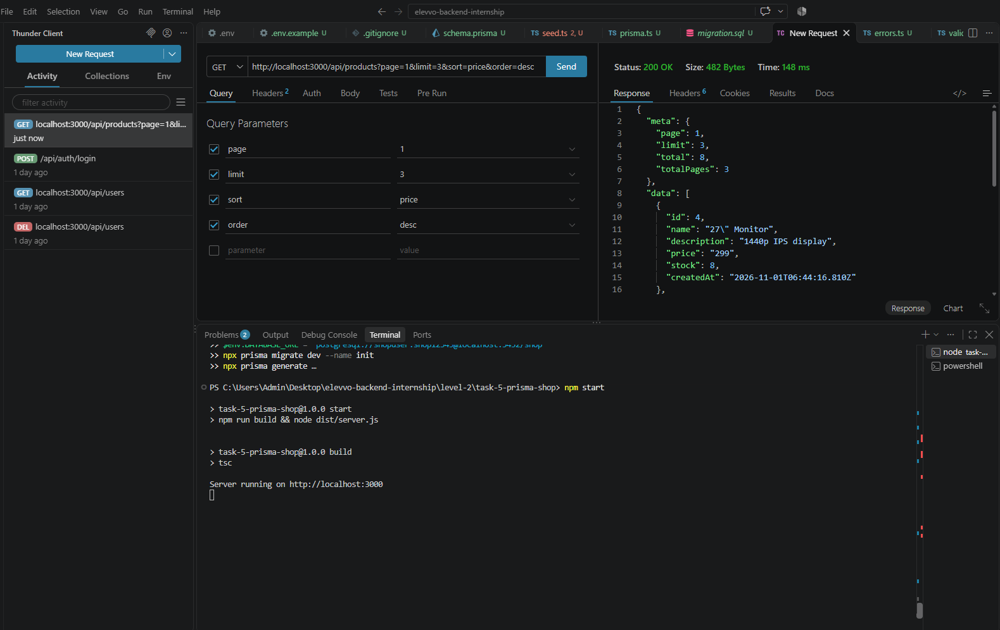

**Successful checkout (nested write inside a transaction)**

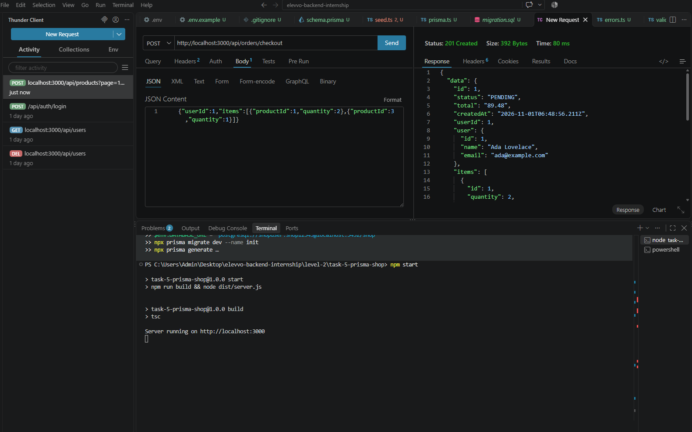

**Failed checkout rolls back the stock deduction**

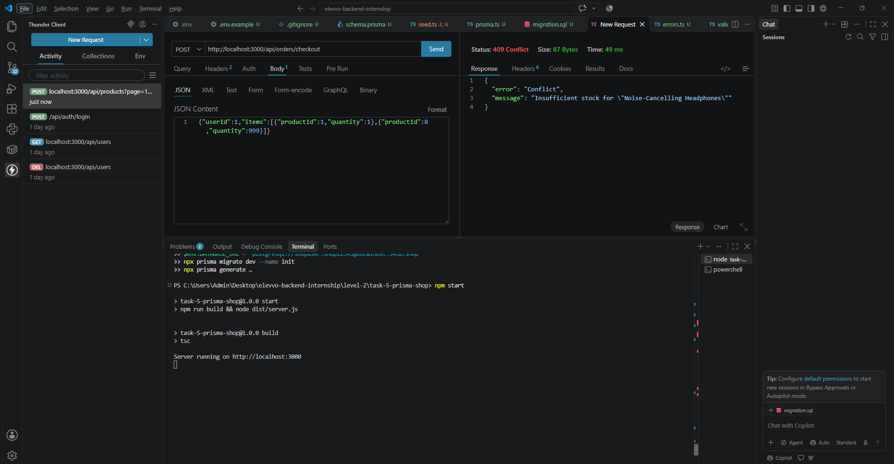

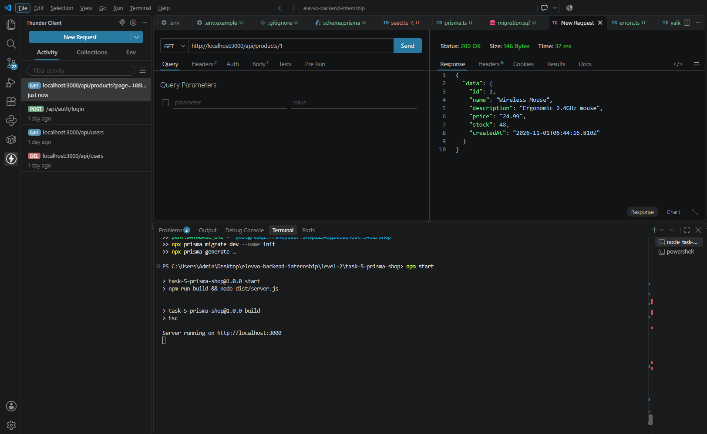

#### Concepts covered

Relational schema design, SQL migrations, Prisma query builder, pagination and filtering, relational integrity (ACID).

## Level 3

### Task 6: High-Performance Caching & Distributed Rate Limiting with Redis

Folder: [`level-3/task-6-redis-cache`](level-3/task-6-redis-cache)

The Task 5 shop API with **Redis** as a cache-aside layer for product reads (1-hour TTL) and as the shared store for a distributed rate limiter. **Bonus:** active cache invalidation when a product is updated or deleted.

**Run it:** `docker compose up -d`, then `npm install`, `npx prisma generate`, `npm start`.

| Feature | How |
|---|---|
| Cache-aside | Redis first, PostgreSQL only on a miss, stored with `EX 3600`. `X-Cache: HIT / MISS` header. |
| Cache keys | `products:item:<id>` and `products:list:<normalized query>` |
| Invalidation (bonus) | `PUT` / `DELETE` purge the product key and all list keys; `POST` and successful checkout purge too (`SCAN` + `UNLINK`) |
| Distributed rate limit | `express-rate-limit` + `rate-limit-redis`: counters stored in Redis (`rl:api:<ip>`), shared by every instance |
| Fail-open | If Redis is down, the API still works from PostgreSQL |

**Cache MISS, then HIT**

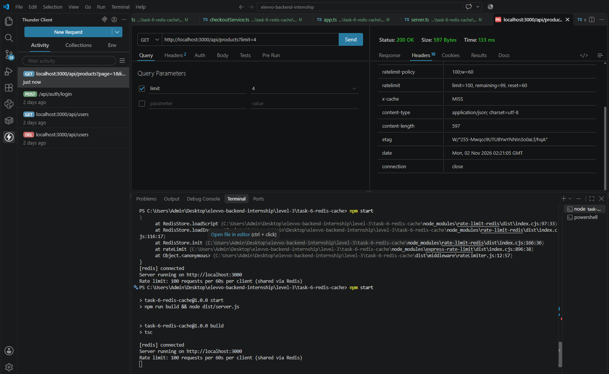
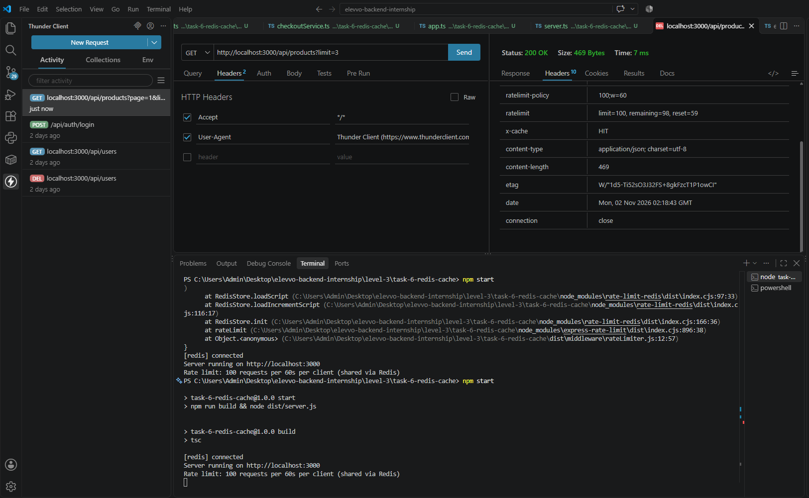

**Redis container and cached keys (TTL about 1 hour)**

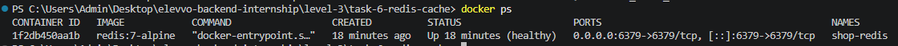
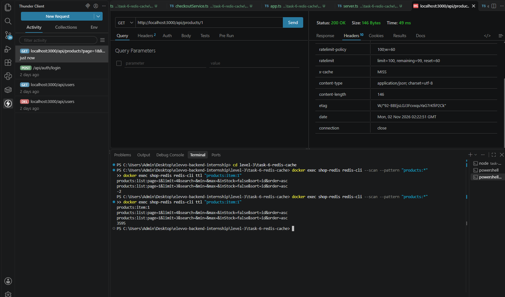

**Invalidation: after `PUT /api/products/1` the keys are purged and the next read returns the new price**

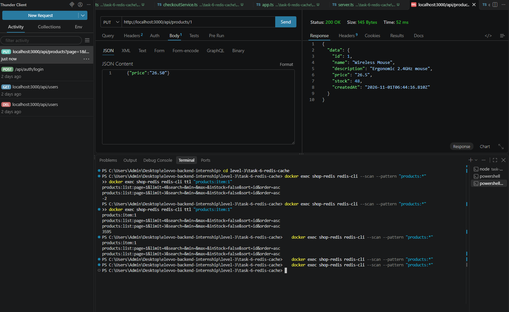
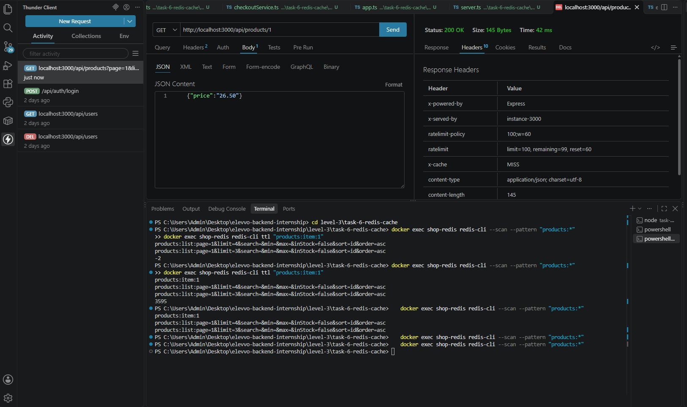
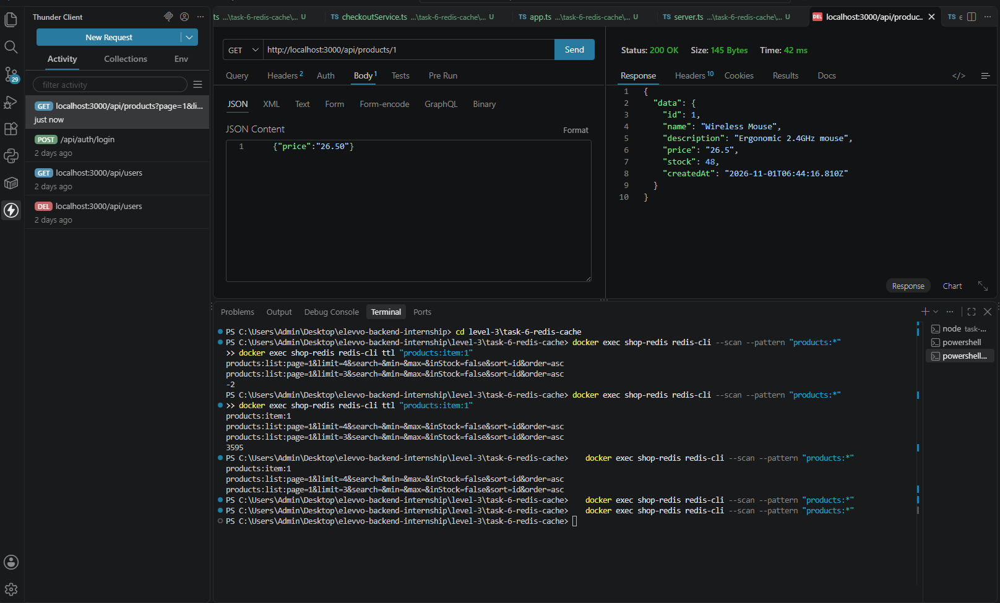

**Benchmark: 14.81 ms (PostgreSQL) vs 1.9 ms (Redis), 7.8x faster**

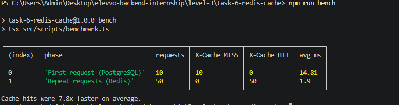

**Distributed rate limit: two instances, one shared counter, the 6th request gets 429**

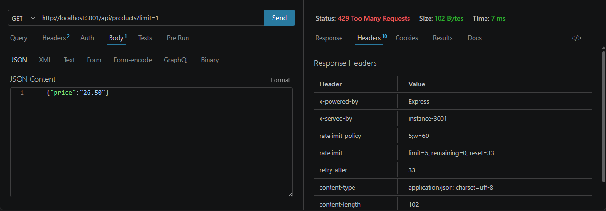


See the [task README](level-3/task-6-redis-cache/README.md) for the full explanation and known limitations.