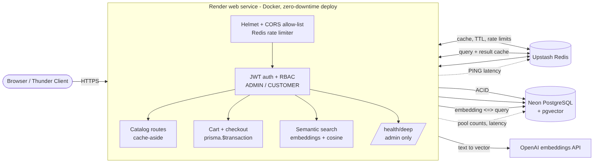
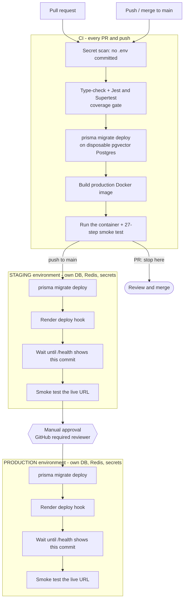

# Task 10: Production-Grade E-Commerce System & Zero-Downtime Cloud Deployment

The capstone: the modules from Tasks 3 to 9 assembled into **one production API** and deployed through an automated
**GitHub Actions pipeline** (tests, migrations, Docker build, staging, approval, production) to **Render + Neon + Upstash**.



## What was assembled from where

| Requirement | Task | Where in this project |
|---|---|---|
| JWT stateless auth, bcrypt, RBAC `ADMIN`/`CUSTOMER`, Helmet, strict CORS, distributed rate limiting | 4 | `src/services/authService.ts`, `src/middleware/{authenticate,authorize,security,rateLimiter}.ts`, `src/controllers/authController.ts` |
| PostgreSQL + Prisma, atomic cart checkout in `$transaction` | 5 | `prisma/schema.prisma`, `src/services/checkoutService.ts`, `src/controllers/cartController.ts` |
| Redis cache-aside for catalog routes | 6 | `src/lib/cache.ts`, `src/controllers/productController.ts` |
| Multi-stage Docker + GitHub Actions | 7 | `Dockerfile`, `.github/workflows/task-10-*.yml` |
| Event/async ideas, health checks | 8 | `/health`, graceful shutdown in `src/server.ts` |
| Semantic vector search (pgvector, cached) | 9 | `src/search/`, `src/embeddings/` |
| **Bonus** `GET /health/deep` | 10 | `src/lib/healthMetrics.ts` |

Task 4 used an in-memory user list and roles `USER`/`ADMIN`. Here users live in PostgreSQL (`User.passwordHash`, `User.role`),
roles are `ADMIN`/`CUSTOMER`, and the login limiter moved from memory to Redis so it works across several instances.

## API and who may call it

| Route | Who |
|---|---|
| `POST /api/auth/register` (always creates a `CUSTOMER`), `POST /api/auth/login` | public |
| `GET /api/auth/me` | any logged-in user |
| `GET /api/products`, `GET /api/products/:id`, `GET /api/products/search?q=` | public (Redis cached) |
| `POST/PUT/DELETE /api/products` | `ADMIN` |
| `GET /api/cart`, `PUT /api/cart/items`, `DELETE /api/cart/items/:productId`, `POST /api/cart/checkout` | logged-in user (own cart only) |
| `POST /api/orders/checkout` ("buy now"), `GET /api/orders`, `GET /api/orders/:id` | logged-in user; customers see only their own orders |
| `GET/PUT/DELETE /api/users`, `PATCH /api/users/:id/role`, `GET /api/search/popular` | `ADMIN` |
| `GET /health` (probe) | public |
| `GET /health/deep` | `ADMIN` |

### Security decisions
- Passwords: bcrypt (cost 12, a random salt per user). Only the hash is stored and it is never selected into a response.
- JWT: HS256 pinned (no `alg: none`), 1 hour life, claims `sub`, `email`, `role`. **Stateless**: no lookup per request. Trade-off: a role change applies after the old token expires.
- Login timing: an unknown e-mail still runs a bcrypt compare, so response time does not reveal which e-mails exist.
- Registration can never choose a role. The first admin comes from `npm run seed:admin` (environment variables).
- Orders of other customers return 404 (not 403), so order ids are not revealed.
- The server **refuses to start in production** without a `JWT_SECRET` of at least 32 characters.
- Login brute force: 5 failed attempts per 15 minutes per IP, counted in Redis (shared by all instances). `trust proxy` is set so the IP is the real client behind Render.

### Transactional core
`POST /api/cart/checkout` runs **one** `prisma.$transaction`: read the cart, deduct stock with a conditional
`UPDATE ... WHERE stock >= qty` (check and deduct in one statement), create the order and its items, empty the cart.
Any failure rolls back everything: stock is untouched and the cart keeps its items. Products are locked in id order to avoid deadlocks.
Verified with 20 simultaneous buyers for 5 items: exactly 5 orders, 15 conflicts, final stock 0.

## Bonus: `GET /health/deep` (ADMIN)
```json
{ "status": "ok", "version": "<commit sha>", "uptimeSeconds": 412,
  "memory": { "rssMb": 98.1, "heapUsedMb": 43.7, "heapLimitMb": 2096, "heapUsedPercent": 2.1 },
  "eventLoopDelayMs": { "mean": 10.4, "p99": 11.9, "max": 15.2 },
  "postgres": { "status": "up", "latencyMs": 1.8, "pool": { "max": 10, "total": 2, "idle": 2, "active": 0, "waiting": 0 } },
  "redis": { "status": "up", "latencyMs": 0.85 }, "embeddings": "ready", "warnings": [] }
```
`status` is `ok`, `degraded` (Redis down, heap above 90%, or requests waiting for a connection; HTTP 200) or `down` (PostgreSQL unreachable; HTTP 503).
The pool numbers come from the real `pg.Pool` that Prisma uses (the pool is created in `src/lib/prisma.ts` and handed to Prisma's adapter).

## CI/CD pipeline



Files: `.github/workflows/task-10-ci-cd.yml` (gates + orchestration) and `task-10-deploy.yml` (reusable, run once per environment).

1. **Test**: secret scan (fails if a `.env` is committed), type-check, Jest + Supertest with a coverage gate, `prisma migrate deploy` on a throw-away pgvector PostgreSQL service.
2. **Docker**: builds the production image and runs **that container** against disposable PostgreSQL and Redis, then runs the 27-step end-to-end smoke test (`npm run smoke`).
3. **Staging** (push to `main` only): `prisma migrate deploy` against the staging database, ensure the admin exists, trigger the Render deploy hook, wait until `/health` reports this exact commit, run the smoke test on the live URL.
4. **Production**: the same job, in the `production` GitHub Environment. Add *Required reviewers* to that environment for a manual approval.

Zero downtime: Render starts the new container, waits for `/health` to pass, then switches traffic and stops the old one.
Migrations run *before* the new code, so they must be backward compatible (add columns/tables, remove things in a later release). The migration in this task only adds.

### Secrets and environment isolation
Nothing secret is committed (`.env` is git-ignored, the pipeline fails if one is tracked).

| Where | What | Why |
|---|---|---|
| GitHub Environment secrets (per environment) | `DIRECT_URL`, `RENDER_DEPLOY_HOOK_URL`, `ADMIN_EMAIL`, `ADMIN_PASSWORD`; variable `APP_URL` | pipeline only: migrations, deploy trigger, smoke test |
| Render environment variables (per service) | `DATABASE_URL`, `REDIS_URL`, `JWT_SECRET`, `OPENAI_API_KEY`, `ALLOWED_ORIGINS` | runtime only, never visible to GitHub |

Staging and production each have their own Neon branch, Upstash database, Render service, JWT secret and admin password.
See **[DEPLOYMENT.md](DEPLOYMENT.md)** for the click-by-click setup.

## Run locally
```bash
docker compose up -d postgres redis        # PostgreSQL + pgvector on 5436, Redis on 6383
cp .env.example .env                       # on Windows: copy .env.example .env
npm install
npx prisma migrate dev
npm run db:seed && npm run seed:catalog    # demo users: admin@example.com / Admin@12345, ada@example.com / Customer@123
EMBEDDING_PROVIDER=hash npm run dev        # or "transformers" for the real local model
npm run smoke                              # end-to-end check against http://localhost:3000 (add SMOKE_ADMIN_* for the admin steps)
npm test                                   # 230 tests, no database needed
```
Full stack in containers: `docker compose up -d --build`.

## Tests
`npm test` runs 230 Jest + Supertest tests (auth, RBAC matrix, cart, atomic checkout rollback, cache, search, deep health, CORS/Helmet, config guard).
`npm run smoke` is the real end-to-end journey and is also what the pipeline runs against staging and production.

## Honest limits
- The Docker image and the GitHub Actions workflows were checked for syntax and by simulating their steps (production-only install, migrations on real PostgreSQL, the smoke test), but they first run for real on your GitHub and Render accounts.
- Render's free instance sleeps when idle, so the first request after a pause is slow. The pipeline and smoke test wait for it.
- The smoke test leaves a few `[smoke]` products (stock 0) and test customers in the database of each environment.
