# Task 8: Event-Driven Order Processing (Industry Level)

`POST /api/orders` no longer does the slow work. It saves the order as `PENDING`, publishes an
`OrderCreated` event to a message broker and answers **`202 Accepted`** immediately. Separate worker
processes consume the event in the background: one reserves stock, one sends the confirmation email.
If a worker fails, the event is retried with **exponential backoff**, and events that can never succeed
land in a **Dead Letter Queue (DLQ)** instead of being lost.

## Architecture

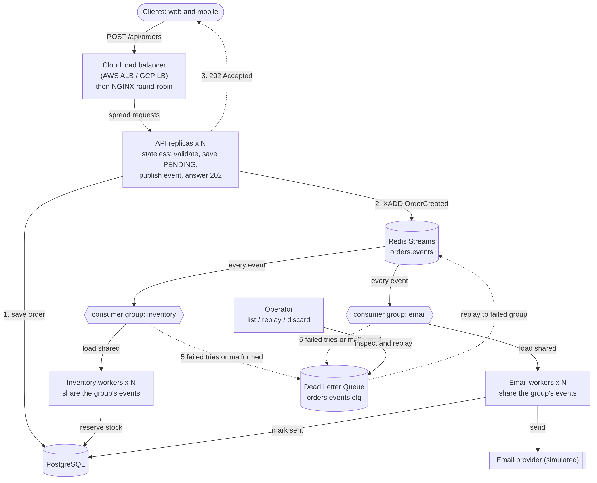

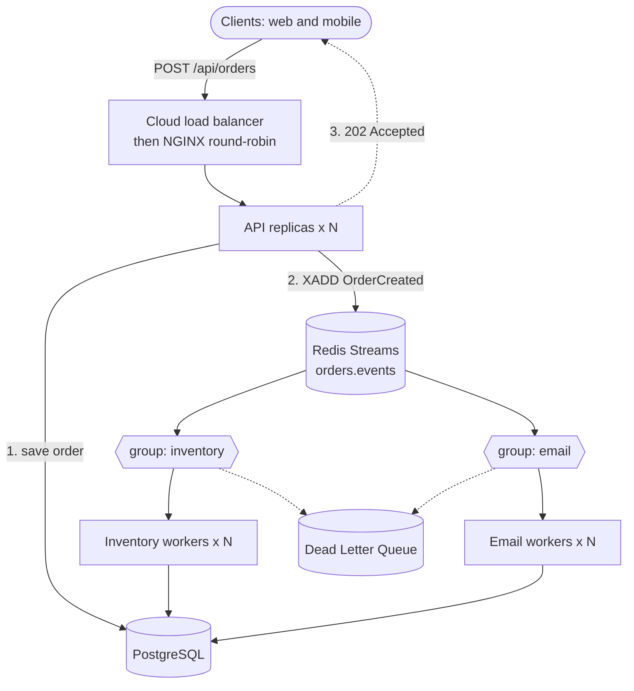

| Piece | What it does |
|---|---|
| NGINX (`nginx/nginx.conf`) | Load balancer. Spreads requests over every `api` replica (round-robin) and re-discovers replicas every 5 s. In the cloud an AWS ALB / GCP load balancer sits in front of this. |
| API (`src/server.ts`, replicas) | Stateless **publisher**. Validates, saves the order, publishes the event, answers 202. |
| Redis Streams (`orders.events`) | The **message broker**. Persistent, with acknowledgements. |
| Consumer groups `inventory` and `email` | Publisher/subscriber fan-out: **each group receives every event**. Workers inside one group **share** the events, which is how you scale a subscriber horizontally. |
| `worker-inventory` | Reserves stock in one atomic transaction, sets the order to `CONFIRMED` (or `CANCELLED` if stock is short). |
| `worker-email` | Sends the (simulated) confirmation email. |
| `orders.events.dlq` | Dead Letter Queue for events that cannot be processed. |

## Why Redis Streams and not plain Redis Pub/Sub

Plain Pub/Sub is fire-and-forget: if no worker is connected at that moment, or a worker crashes mid-message,
the message is gone. That breaks the requirement "the message must not be lost". Streams keep every event on
disk, track which worker has which event until it is acknowledged (`XACK`), and let another worker take over
(`XAUTOCLAIM`). They still give the publish/subscribe behaviour through consumer groups.

## Fault tolerance

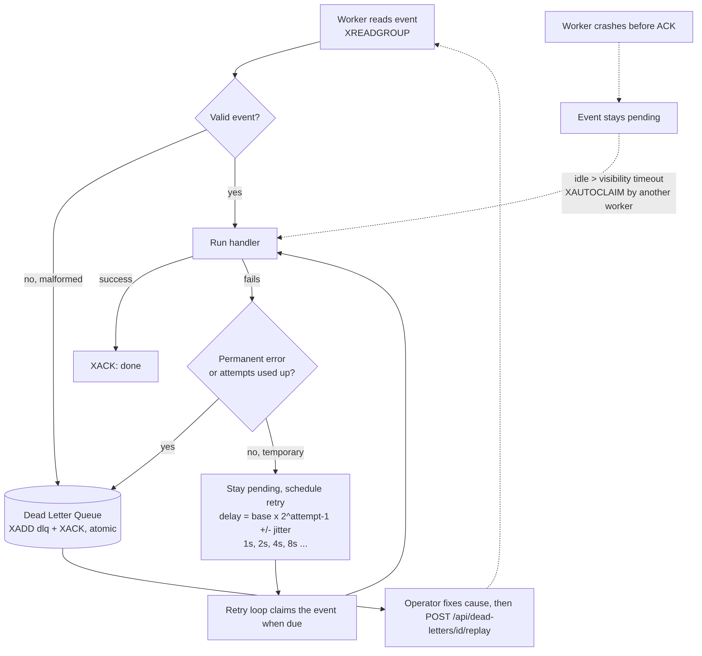

* **At-least-once delivery.** An event is acknowledged only after the handler finished. A crash leaves it
  pending, and after `VISIBILITY_TIMEOUT_MS` another worker recovers it.
* **Retry with exponential backoff.** `delay = min(max, base x 2^(attempt-1))` with 20 % jitter:
  about 1 s, 2 s, 4 s, 8 s (max 30 s). The event stays pending while it waits, so it cannot be lost.
* **Dead Letter Queue.** After `WORKER_MAX_ATTEMPTS` (default 5) failures, or immediately for malformed
  events / permanent errors, the event is copied to `orders.events.dlq` and acknowledged in one atomic
  `MULTI/EXEC`. It keeps the group, error, attempts and the original payload.
* **Replay.** `POST /api/dead-letters/:id/replay` re-publishes the event for **only the group that failed**
  (the other group skips it), then removes it from the DLQ.
* **Idempotent handlers** (because delivery is "at least once"): the inventory worker only touches orders that are
  still `PENDING`; the email worker skips orders whose `confirmationEmailSentAt` is set. Duplicates change nothing.
* **Insufficient stock is not a failure.** It is a business outcome: the order becomes `CANCELLED` with a
  `failureReason`; no retry and no DLQ.
* **Broker down.** The API cancels the order (`enqueue_failed`) and answers `503`. Workers keep running and
  reconnect by themselves.

Known limitation: saving the order and publishing the event are two separate writes (the "dual write"
problem). The production fix is the **transactional outbox** pattern. Also, the ops endpoints have no authentication.

## Run it (Docker Compose)

```bash
docker compose up -d --build
docker compose ps
```

Everything is reached through the load balancer at `http://localhost:8080`.

Scale out (no code change):

```bash
docker compose up -d --scale api=4 --scale worker-inventory=4
```

## API

| Method | Path | Result |
|---|---|---|
| POST | `/api/orders` | `202 Accepted` `{ data: { orderId, status: "PENDING", eventId } }` + `Location` header |
| POST | `/api/orders/checkout` | original synchronous version (`201`), kept for comparison |
| GET | `/api/orders/:id` | order status: `PENDING`, `CONFIRMED`, `CANCELLED` |
| GET | `/api/stats/queues` | stream length, per-group pending / lag, DLQ size |
| GET | `/api/dead-letters` | dead letters |
| POST | `/api/dead-letters/:id/replay` | replay to the failed group |
| DELETE | `/api/dead-letters/:id` | discard |
| GET / POST | `/api/admin/chaos` | `{ "service": "email", "mode": "always" \| "off" \| 3 }` makes a service fail on purpose |

## Tests

`npm test`: unit tests for backoff, events, the consumer (retry, DLQ, crash recovery using an in-memory
fake of Redis Streams), the handlers, chaos/DLQ operations, and the API (`202`, `400`, `404`, `503`).


## Screenshots

### Containers running (API x2, inventory workers x2, email worker, NGINX, PostgreSQL, Redis)
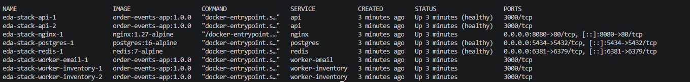

### 202 Accepted returned immediately
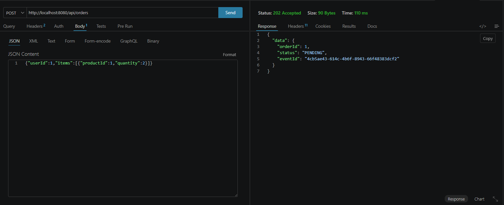

### Order processed in the background (PENDING to CONFIRMED)
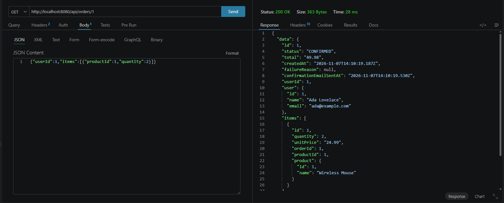

### Email worker consumed the events
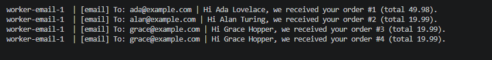

### NGINX load balancing across API replicas
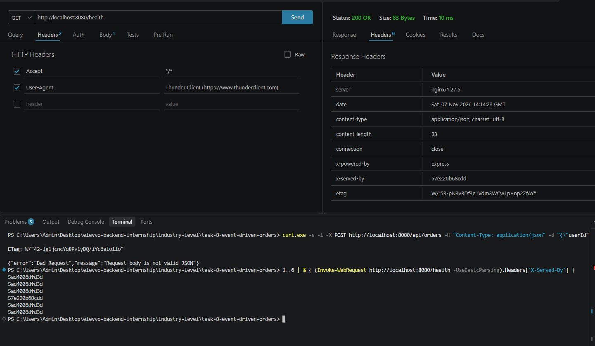

### Retry with exponential backoff (email service failing 3 times, then recovering)
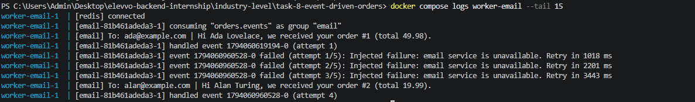

### Event moved to the Dead Letter Queue after the maximum attempts
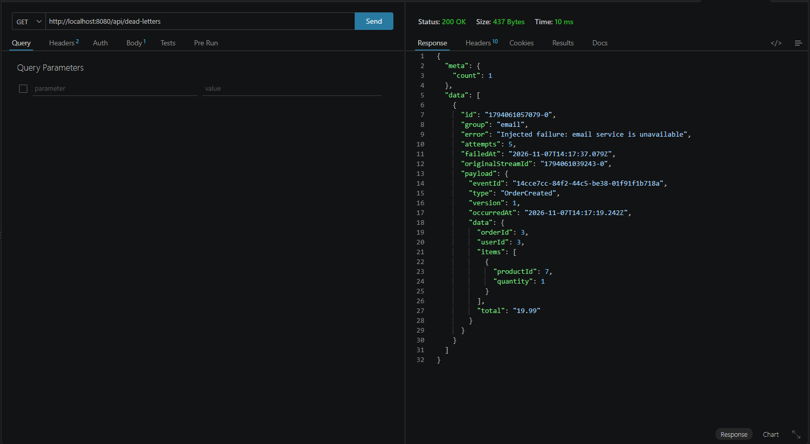

### Replaying a dead letter after the fix
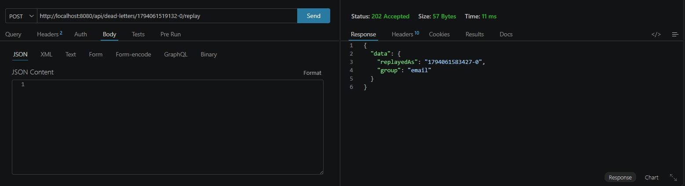
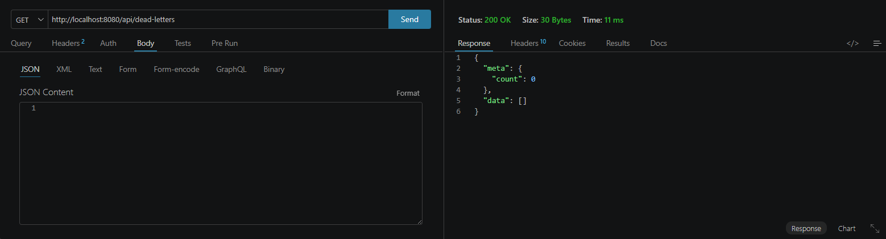
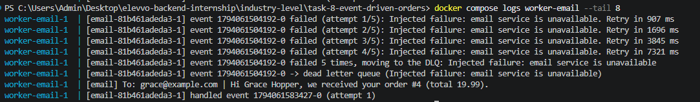

### Poison message goes straight to the DLQ (no retries)
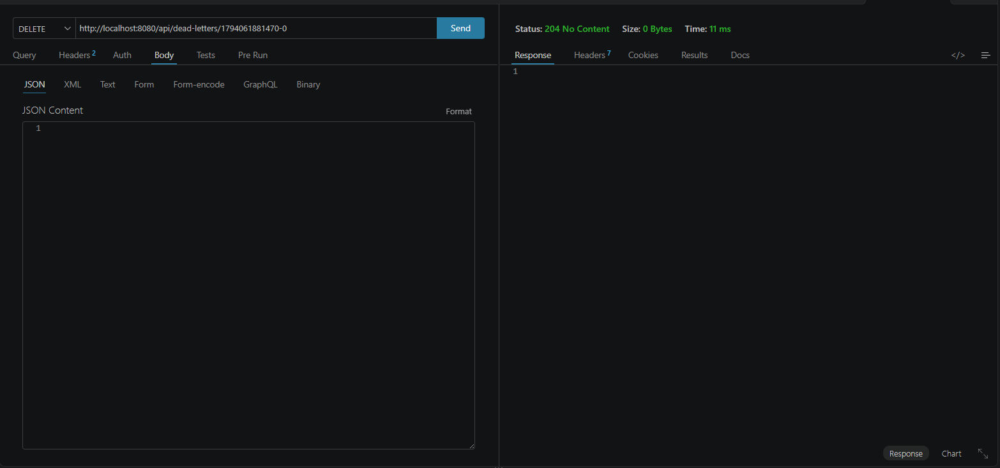

### Horizontal scaling: 4 API replicas and 4 inventory workers
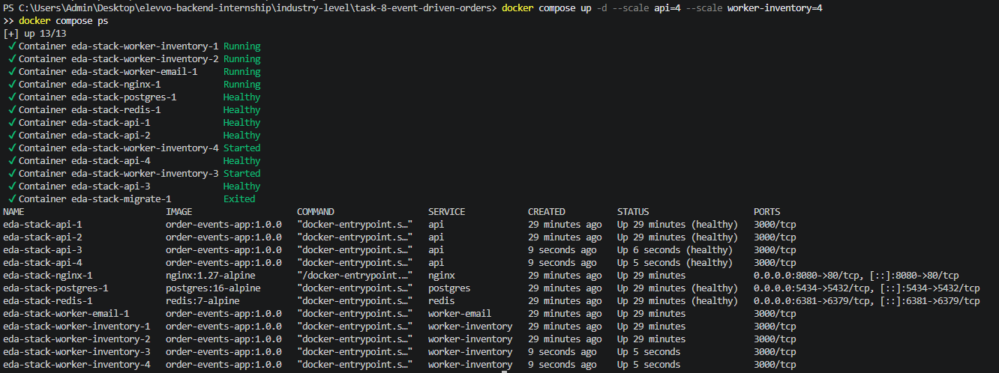
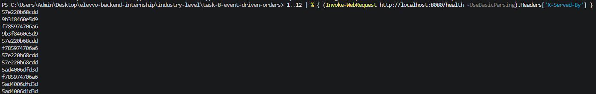
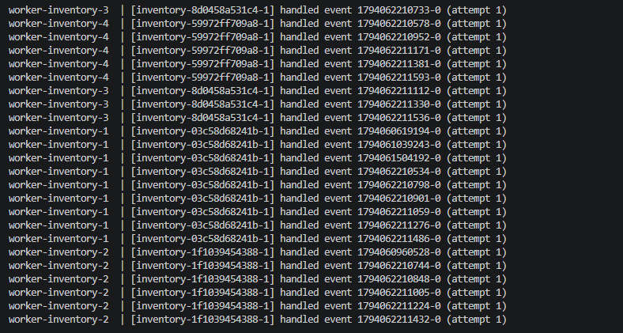

### Queue statistics
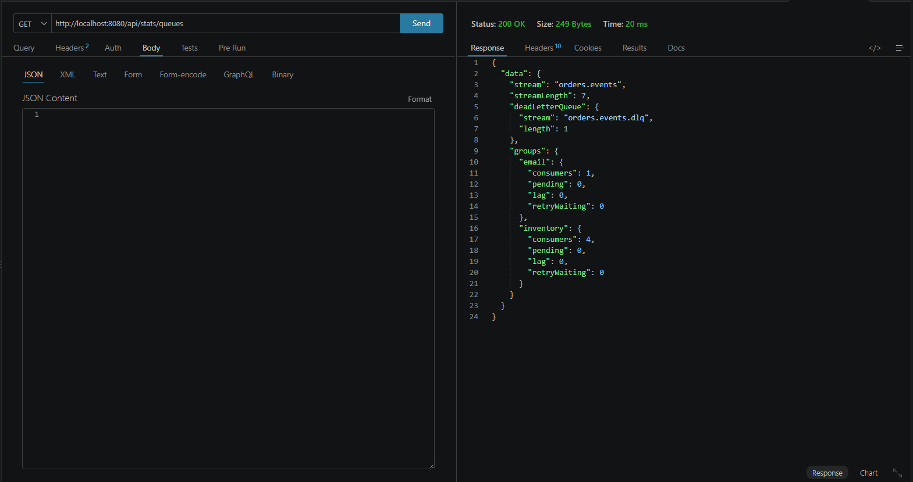

### Tests passing (187 tests)
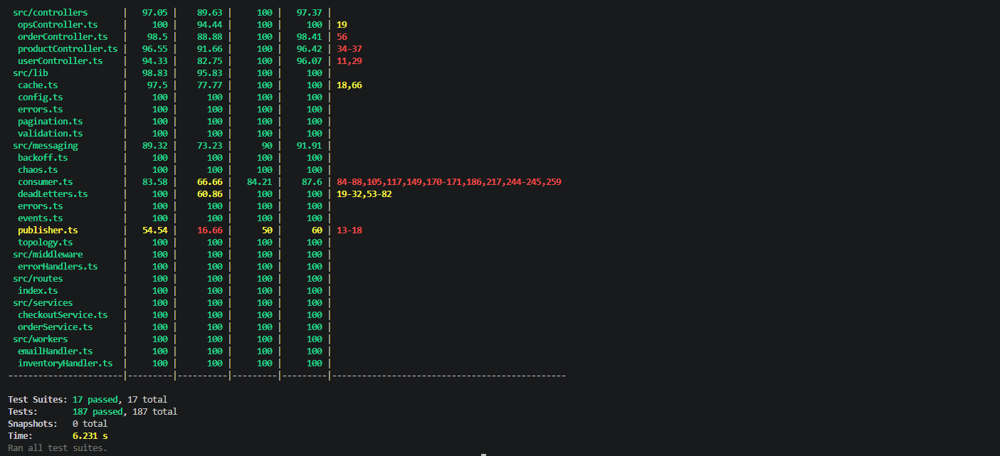