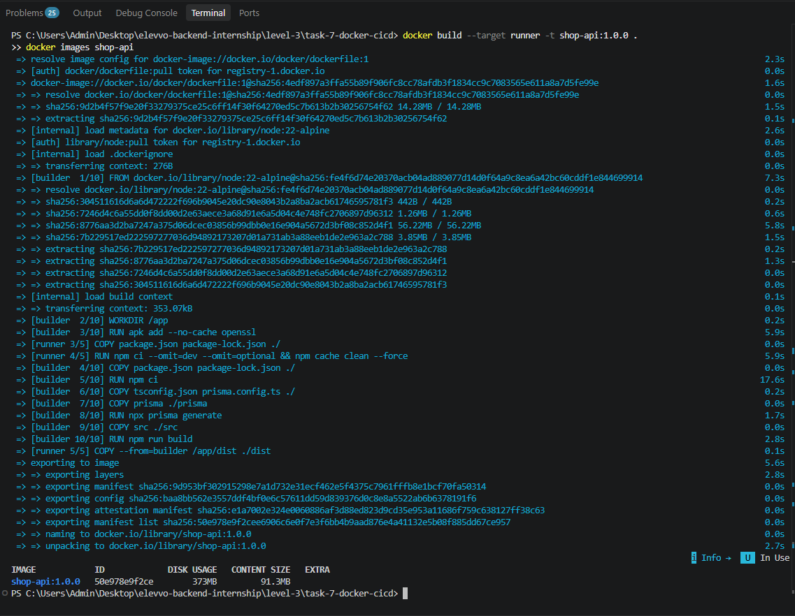
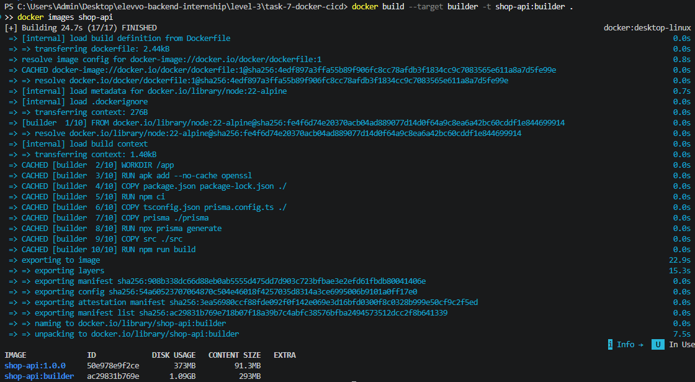
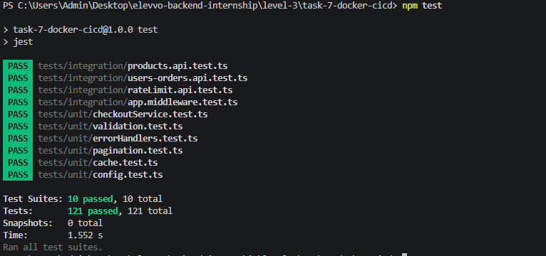
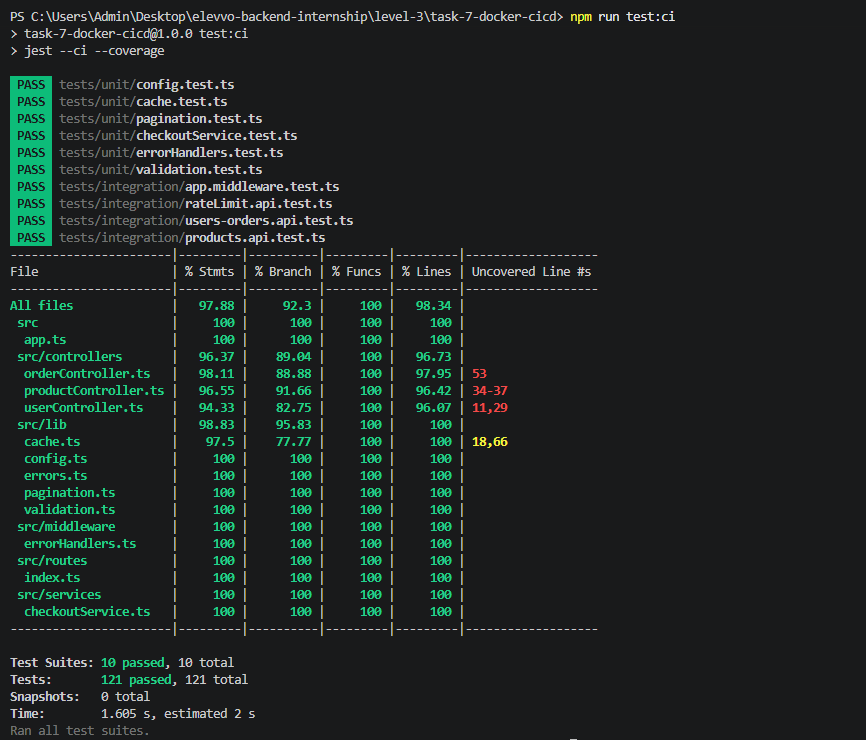
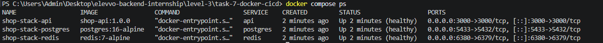
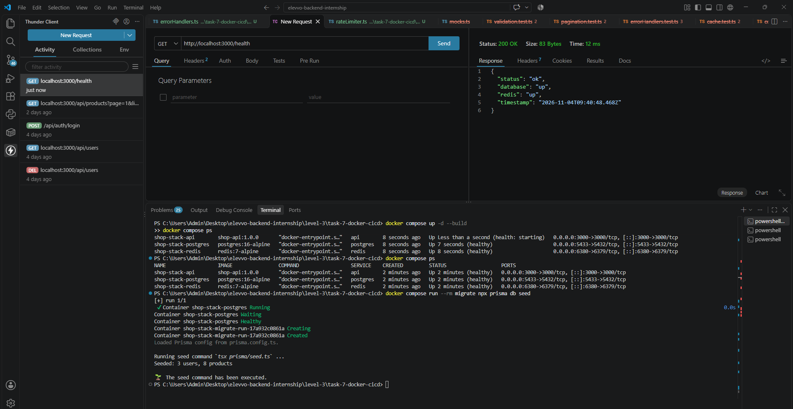
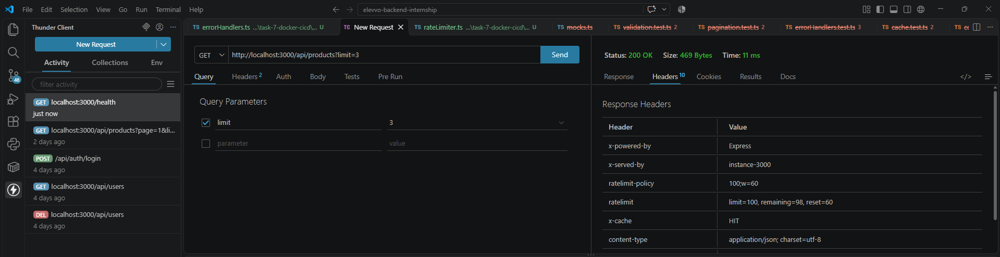

# Task 7: Multi-Stage Dockerization & Automated CI/CD Pipelines

Level 3 · Backend Development Internship (Elevvo)

The Task 6 shop API (Express + Prisma + PostgreSQL + Redis), now packaged in a small multi-stage Docker image, covered by Jest and Supertest tests, orchestrated with Docker Compose, and checked automatically by a GitHub Actions pipeline on every pull request.

**Bonus:** multi-stage builds, CI/CD automation, unit tests, Supertest integration tests, pipeline quality gates, and a Docker Compose stack with health-check dependencies.

## Tech stack

Node.js 22 · TypeScript · Express · Prisma 7 · PostgreSQL 16 · Redis 7 · Jest · ts-jest · Supertest · Docker / Docker Compose · GitHub Actions

## 1. Multi-stage Dockerfile

The `Dockerfile` has two stages, both based on `node:22-alpine`:

| Stage | Purpose | What it contains |
|---|---|---|
| `builder` | Compile | all dependencies (dev included), Prisma CLI, TypeScript, sources. Runs `npm ci`, `prisma generate`, `npm run build` |
| `runner` | Run | production dependencies only (`npm ci --omit=dev --omit=optional`) plus the compiled `dist/` folder |

The runner runs as the non-root `node` user and has a `HEALTHCHECK` that calls `/health` (which also checks PostgreSQL).

`--omit=optional` matters: `@prisma/client` lists the Prisma CLI and TypeScript as optional peers, which npm records as "devOptional". Without that flag, about 250 MB of tooling the running API never uses would still be installed.

A `.dockerignore` keeps `node_modules`, `.env`, tests and `.git` out of the build context, so no secrets end up in the image.

```bash
docker build --target runner -t shop-api:1.0.0 .
docker images shop-api
```



The final image is about 3x smaller than the builder stage (373 MB vs 1.09 GB on disk, 91.3 MB vs 293 MB compressed), because TypeScript, Jest, the Prisma CLI and the sources stay behind in the builder.



## 2. Automated tests (Jest + Supertest)

```bash
npm test          # run all tests
npm run test:ci   # run with coverage (fails below the thresholds)
npm run typecheck # type-check source and tests
```

**121 tests in 10 suites**, all running without a database or Redis. PostgreSQL (Prisma), Redis and the Redis-backed rate limiter are replaced by fakes (`tests/helpers/mocks.ts`).

| Type | Files | What they cover |
|---|---|---|
| Unit | `tests/unit/*` | validation helpers, pagination, config, the cache-aside helpers (HIT, MISS, TTL, fail-open when Redis is down, invalidation), the error-handling middleware (every Prisma error mapping, 400/404/409/413/500), and the checkout service (total, lock order, 409 on low stock, cache purged only on success) |
| Integration (Supertest) | `tests/integration/*` | the real Express app over HTTP: products (cache-aside, `X-Cache` header, invalidation on PUT/POST/DELETE, bad input), users, orders and checkout, `/health` (database and Redis up/down), global middleware (404, malformed JSON, oversized body, no stack traces) and the rate limiter returning 429 |



**Coverage quality gate:** `jest.config.js` requires at least 80% statements, 70% branches, 80% functions and 80% lines. If coverage drops below that, `npm run test:ci` fails, and so does the pipeline. Current coverage is about 98%. The Redis and Prisma client setup files and `server.ts` are excluded, because they only wire up real connections.



Writing these tests found a real bug: a JSON body over the 100 kb limit returned `500` instead of `413 Payload Too Large`. It is fixed in `src/middleware/errorHandlers.ts`.

## 3. Docker Compose stack (bonus)

`docker-compose.yml` runs four services with health-checked start-up order:

```
postgres (healthy) + redis (healthy)  ->  migrate (runs once, exits 0)  ->  api
```

| Service | Image | Notes |
|---|---|---|
| `postgres` | `postgres:16-alpine` | health check `pg_isready`, data in the `pgdata` volume, host port 5433 |
| `redis` | `redis:7-alpine` | health check `redis-cli ping`, memory capped at 128 MB (LRU eviction), host port 6380 |
| `migrate` | builder stage | one-off `prisma migrate deploy`, exits when done |
| `api` | runner stage | starts only after both databases are healthy and the migration succeeded (`service_completed_successfully`), port 3000 |

```bash
docker compose up -d --build
docker compose ps
docker compose run --rm migrate npx prisma db seed   # optional sample data
docker compose down                                   # add -v to delete the database volume
```

Inside the Compose network the containers reach each other by service name (`postgres`, `redis`). The stack has its own PostgreSQL, separate from one installed on your computer. Host ports 5433 and 6380 are used so the stack does not clash with a local PostgreSQL (5432) or the Task 6 Redis container (6379). The database password defaults to a development value. Override it with the `POSTGRES_PASSWORD` environment variable.





## 4. CI pipeline (GitHub Actions)

`.github/workflows/ci.yml` (at the repository root) runs on every **pull request to